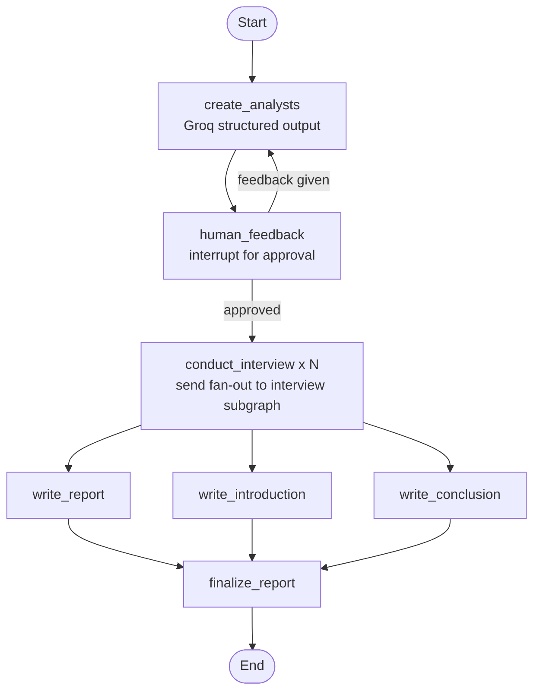
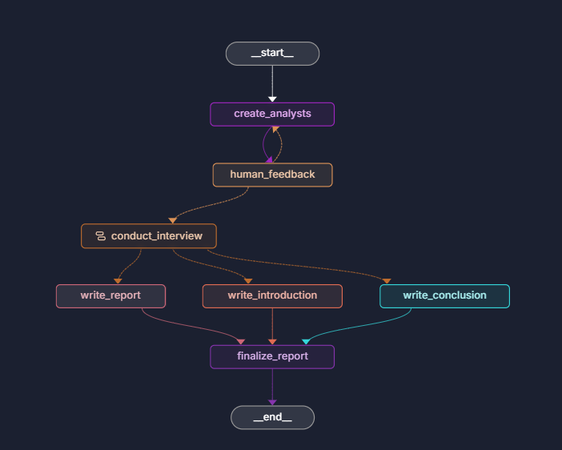
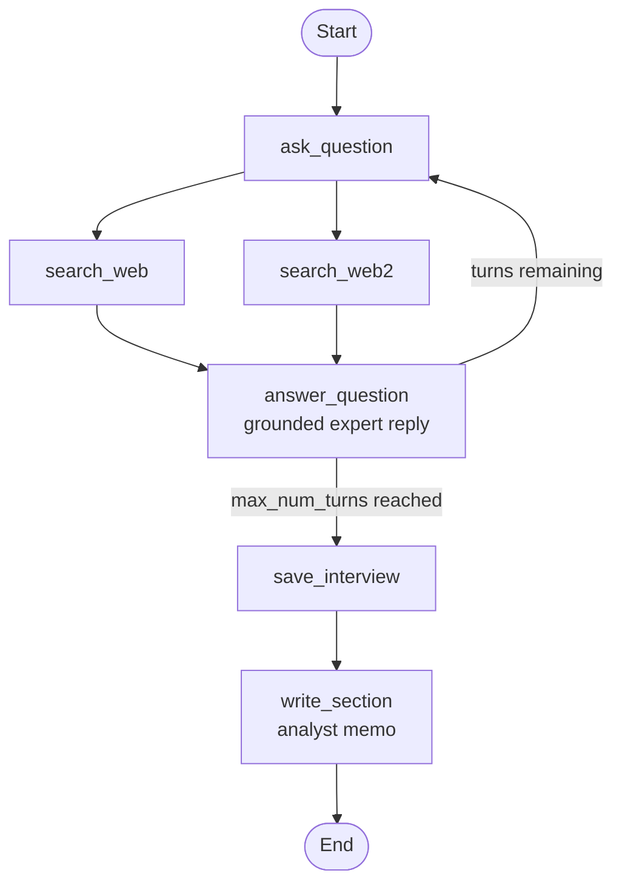
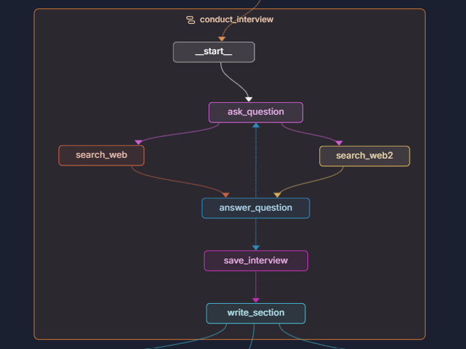

# Research Agent

A multi-agent **LangGraph** pipeline that turns a single topic into a team of AI analyst personas, runs parallel expert interviews grounded in live web search, and synthesizes the findings into a cited research report — with a human-in-the-loop checkpoint before any interviews run.

## Overview

The pipeline performs four stages of work:

1. **Analyst generation** — an LLM produces a cast of analyst personas (`name`, `role`, `affiliation`, `description`), each owning one theme of the topic.
2. **Human approval** — execution pauses at an interrupt so a human can approve the analysts or provide feedback to regenerate them.
3. **Parallel expert interviews** — one interview subgraph runs per analyst (`Send` fan-out). Each interview loops: generate a question → derive web-search queries → retrieve live context via Tavily → produce a grounded expert answer → repeat for `max_num_turns` → save the transcript → write a memo section.
4. **Report synthesis** — an introduction, a consolidated insights body, and a conclusion are written in parallel, then assembled into a final report with a sources list.

## Architecture

### Full pipeline — `research_agent`



**As rendered in the LangGraph playground:**



### Interview subgraph — `question_answer_graph`



**As rendered in the LangGraph playground:**



### Registered graphs

| Graph name | Entry point | Purpose |
|---|---|---|
| `research_agent` | `src/agent.py:graph` | Full pipeline: analysts → interviews → final report |
| `create_analyst` | `src/creatingAnalysts.py:graph` | Standalone analyst generation + feedback loop |
| `question_answer_graph` | `src/answeringQuestion.py:question_answer_graph` | Standalone single-expert interview → memo section |

## Prerequisites

- **Python 3.12+**
- **[uv](https://docs.astral.sh/uv/)** (recommended) or `pip`
- **Groq API key** — [console.groq.com/keys](https://console.groq.com/keys) (model inference)
- **Tavily API key** — [app.tavily.com](https://app.tavily.com) (web search)
- *(Optional)* **LangSmith API key** for tracing

## Setup

### Using uv (recommended)

```bash
git clone <your-repo-url>
cd ResearchAgentProject
uv sync
```

### Using pip (alternative)

```bash
git clone <your-repo-url>
cd ResearchAgentProject
python -m venv .venv

# Windows
.venv\Scripts\activate
# macOS/Linux
source .venv/bin/activate

pip install -r requirements.txt
```

### Environment variables

Create a `.env` file in the project root (it is git-ignored):

```bash
GROQ_API_KEY=your_groq_api_key
TAVILY_API_KEY=your_tavily_api_key

# Optional — LangSmith tracing
LANGCHAIN_TRACING_V2=true
LANGCHAIN_API_KEY=your_langsmith_api_key
```

`langgraph.json` loads this file automatically at server start.

## Running

Start the local LangGraph dev server:

```bash
# uv
uv run langgraph dev

# pip (with virtualenv activated)
langgraph dev
```

Open the playground at **http://127.0.0.1:2024**, pick a graph, and start a thread with an input payload. The in-memory runtime means threads reset when the server restarts.

### Example input — `research_agent`

```json
{
  "topic": "The impact of AI coding assistants on software engineering jobs",
  "max_analysts": 3,
  "human_analyst_feedback": ""
}
```

The run will pause at the `human_feedback` interrupt and show the generated analysts. Resume the thread with:

- **free-text feedback** → analysts are regenerated with your guidance, or
- **`okay`** (also `perfect`, `continue`, or empty string) → approve and continue into interviews.

### Example input — `question_answer_graph`

All four `Analyst` fields are required:

```json
{
  "messages": [],
  "max_num_turns": 2,
  "analyst": {
    "name": "Dr. Elena Rostova",
    "affiliation": "Mayo Clinic",
    "role": "Chief Medical Information Officer",
    "description": "Focuses on clinical validation of AI diagnostics and integration into hospital workflows."
  }
}
```

### Example output — `research_agent`

```json
{
  "final_report": "# <Report title>\n## Introduction\n...\n---\n<consolidated insights>\n---\n## Conclusion\n...\n## Sources\n[1] https://...\n[2] https://..."
}
```

Intermediate state (`sections` memos, `interview` transcripts) is visible in the thread state viewer of the playground.

## Project structure

```
ResearchAgentProject/
├── langgraph.json              # Graph registry for `langgraph dev`
├── pyproject.toml              # uv project metadata & pinned dependencies
├── requirements.txt            # pip alternative to uv.lock
├── .env                        # API keys (git-ignored, not committed)
├── src/
│   ├── agent.py                # Full research pipeline graph (research_agent)
│   ├── creatingAnalysts.py     # Analyst generation graph (create_analyst)
│   ├── answeringQuestion.py    # Interview subgraph (question_answer_graph)
│   └── utils/
│       ├── models.py           # ChatGroq model configuration
│       ├── nodes.py            # All node implementations
│       ├── edges.py            # Routers + Send() fan-out logic
│       ├── states.py           # TypedDict state schemas for each graph
│       ├── objects.py          # Pydantic models: Analyst, Perspectives, SearchQuery
│       └── prompts.py          # All prompt templates
```

## How it works

**1. Analyst generation** — `create_analysts` (in `src/utils/nodes.py`) calls Groq with `with_structured_output(Perspectives, method="json_schema", strict=True)`, so constrained decoding forces the model to return `{"analysts": [...]}` conforming to the Pydantic schema in `src/utils/objects.py`. The number of analysts is controlled by `max_analysts`.

**2. Human-in-the-loop gate** — `human_feedback` uses LangGraph's `interrupt()` to surface the generated analysts for review. Feedback (or approval) is routed by the `initiate_all_interviews` conditional edge in `src/utils/edges.py`.

**3. Interview fan-out** — `initiate_all_interviews` emits one `Send("conduct_interview", {...})` per analyst. Each Send runs an isolated copy of the interview subgraph (`src/answeringQuestion.py`):

- `generate_question` — the analyst persona asks a follow-up question;
- `search_web` / `search_web2` — the question is converted into a structured `SearchQuery` (again via `json_schema` with `strict=True`) and executed against **Tavily**; both nodes contribute documents to the shared `context` channel;
- `generate_answer` — the expert answers using only the retrieved context, with source citations;
- `route_messages` — loops back to another question until `max_num_turns` expert replies are reached, then routes to `save_interview`;
- `save_interview` → `write_section` — the transcript is saved and the model writes an analyst memo.

Memo `sections` accumulate in the parent graph through an `Annotated[list, operator.add]` reducer, so every analyst's memo contributes to the final report.

**4. Report synthesis** — `write_introduction`, `write_report`, and `write_conclusion` run in parallel over the collected memos (`report_writer_instructions` and `intro_conclusion_instructions` in `src/utils/prompts.py`). `finalize_report` concatenates the three parts with horizontal-rule separators and appends the consolidated `## Sources` list.

## Configuration

| Setting | Where | Default |
|---|---|---|
| LLM model | `src/utils/models.py` | `openai/gpt-oss-120b` (Groq) |
| Structured output | `src/utils/nodes.py` | `method="json_schema", strict=True` (constrained decoding) |
| Interview depth | input state `max_num_turns` | `2` |
| Number of analysts | input state `max_analysts` | per request |
| Web results per search | `TavilySearch(max_results=...)` in `search_web` | `2` |
| Analyst/report prompts | `src/utils/prompts.py` | edit templates directly |

> **Groq free-tier note:** the free plan allows ~8K tokens **per minute, per model**. A single oversized request (e.g. accumulated interview context) can be rejected with HTTP `413` even on an otherwise idle account. If that happens, reduce search-result context or upgrade your Groq tier.

## Tech stack

| Component | Purpose |
|---|---|
| [LangGraph](https://langchain-ai.github.io/langgraph/) | Graph orchestration, interrupts, `Send` fan-out, state reducers |
| [LangChain](https://python.langchain.com/) | Message types, runnables, output parsers |
| Groq (`langchain-groq`) | Low-latency LLM inference with structured output |
| Tavily (`langchain-tavily`) | Live web search for interview grounding |
| Pydantic | Output schemas (`Analyst`, `Perspectives`, `SearchQuery`) |
| uv | Dependency management & virtual environments |
